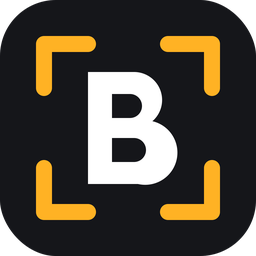

# BCAM

영상을 여러 구간으로 나누고, 구간들을 MP4 / GIF / WebP 로 한번에 저장하는 레퍼런스 클립 편집 툴입니다. (Windows)

## 다운로드

**[최신 버전 받기](https://github.com/qldrna/BCAM-release/releases/latest)** → `BCAM_Setup.exe`

1. `BCAM_Setup.exe` 를 받아 실행하면 설치 마법사가 열립니다. 관리자 권한은 필요 없습니다.
2. 처음 실행할 때 "Windows의 PC 보호" 창이 뜨면 **추가 정보 → 실행**을 누르세요. 개인이 만든 프로그램이라 서명 인증서가 없어서 뜨는 안내입니다.
3. 첫 실행 때 영상 처리에 필요한 ffmpeg(약 150MB)를 자동으로 내려받습니다.
4. 새 버전이 나오면 프로그램이 알려 주고, **지금 업데이트**를 누르면 자동으로 교체됩니다.

설치 없이 쓰고 싶으면 같은 페이지의 `BCAM.exe`(포터블)를 받아 원하는 폴더에 두고 실행하세요.

## 주요 기능

- 타임라인에서 구간을 여러 개 만들고 한번에 저장 (MP4 / GIF / WebP)
- 구간별 크롭, 타이밍 마커(프레임 간격 표시), 태그와 메모
- 구간만 이어서 보기, 체크한 구간을 하나의 파일로 저장
- 장면 전환 자동 감지, 프레임 스냅샷
- 프로젝트 저장과 열기, 저장 폴더에 오프라인 라이브러리 생성

## 이용 안내

- 무료로 사용할 수 있습니다.
- 이 프로그램은 있는 그대로 제공되며, 사용 중 발생한 문제나 손실에 대해 제작자는 책임지지 않습니다.
- 유튜브 가져오기 기능을 쓸 때 영상의 저작권과 서비스 약관을 지킬 책임은 사용자에게 있습니다. 개인적인 참고 용도로만 사용해 주세요.
- 프로그램은 PC 안에서만 동작하며 사용 정보를 수집하거나 외부로 보내지 않습니다. 인터넷 연결은 새 버전 확인과 아래 프로그램을 내려받을 때만 사용합니다.

## 함께 사용하는 프로그램

BCAM 은 아래 프로그램을 설치 파일에 포함하지 않고, 필요할 때 각 프로그램의 공식 배포처에서 내려받아 사용합니다.

- [FFmpeg](https://ffmpeg.org/) — 영상 자르기와 변환
- [yt-dlp](https://github.com/yt-dlp/yt-dlp), [Deno](https://deno.com/) — 유튜브 가져오기 (사용에 동의한 경우에만)
